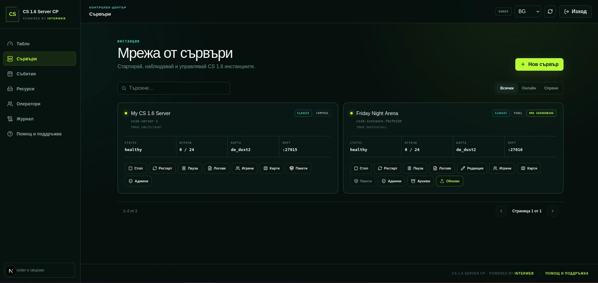

# CS 1.6 Server CP



[Български](README.md) | [English](README.en.md)

A free self-hosted Docker platform for Counter-Strike 1.6 servers. Run Classic
and GunGame instances with AMX Mod X, Metamod, MariaDB statistics, and a modern
web control panel without depending on expensive specialized game hosting.

## Features

- Classic and GunGame modes with separate maps and rotations;
- AMX Mod X administration, map voting, `/rank`, `/stats`, and `/top15`;
- warmup, AFK manager, semiclip, double jump, and kill-streak sounds;
- MariaDB statistics, rankings, seasons, achievements, bans, and audit history;
- dynamic isolated servers with automatic port allocation;
- web management for start/stop/restart, players, maps, admins, and configuration;
- Backup/Restore, image updates, lifecycle recovery, and persistent volumes;
- BG/EN interface, roles and permissions, NGINX, and automatic HTTPS;
- stable Valve HLDS image and an optional ReHLDS/ReGameDLL profile.

## Quick start

Requires `x86_64` Linux, Git, and Docker Engine with the Compose plugin.

```bash
git clone https://github.com/iwebbg/counter-strike-server-docker.git
cd counter-strike-server-docker
./docker/compose setup full
./docker/compose up -d --build
./docker/compose ps
```

`setup full` creates `.env` and generates missing RCON, panel, MariaDB, and Redis
secrets. Review `.env` before publishing any service.

Open the control panel at:

```text
http://127.0.0.1:8080
```

Connect from the CS 1.6 console:

```text
connect SERVER_IP:27015
```

For the game server without the panel:

```bash
./docker/compose setup server
./docker/compose up -d --build
```

Open the interactive launcher with:

```bash
./docker/compose
```

## Select a mode

Set the mode in `.env`:

```dotenv
SERVER_MODE=classic
```

or:

```dotenv
SERVER_MODE=gungame
```

Apply changes with `./docker/compose up -d`.

## Recommended VPS

A practical starting point for two instances with up to 24 players each is:

- 4 vCPU;
- 6–8 GB RAM;
- 80–120 GB SSD;
- 5–10+ TB monthly traffic.

Actual capacity depends on CPU performance, maps, plugins, and player load. See
the [requirements and capacity planning guide](docs/en/REQUIREMENTS.md).

## Documentation

- [Control Panel](docs/en/WEB-PANEL.md)
- [Compose launcher](docs/en/COMPOSE-LAUNCHER.md)
- [Production NGINX and HTTPS](docs/en/HTTPS-PROXY.md)
- [MariaDB schema and statistics](docs/en/DATABASE.md)
- [ReHLDS profile](docs/en/REHLDS.md)
- [Testing](docs/en/TESTING.md)
- [Release checklist](docs/en/RELEASE-CHECKLIST.md)
- [Full roadmap](docs/en/ROADMAP.md)

## Help

Open a [GitHub Issue](https://github.com/iwebbg/counter-strike-server-docker/issues/new)
or email [office@interweb.bg](mailto:office@interweb.bg). Do not publish
passwords, tokens, RCON values, or personal data in logs.

The project downloads official Valve HLDS files through SteamCMD during the
image build and does not distribute game content in this repository.

## Support the project

If CS 1.6 Server CP is useful to your server or community, you can support its
continued maintenance and development:

- [Buy Me a Coffee](https://buymeacoffee.com/interweb.bg)
- [Ko-fi](https://ko-fi.com/interwebltd)
- [PayPal](https://paypal.me/interwebltd)
