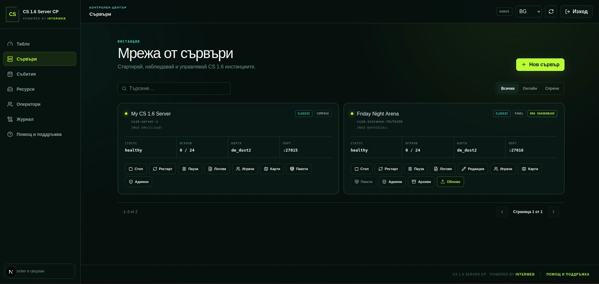

# CS 1.6 Server CP



[Български](README.md) | [English](README.en.md)

Безплатна self-hosted Docker платформа за Counter-Strike 1.6 сървъри. Стартира
Classic и GunGame инстанции с AMX Mod X, Metamod, MariaDB статистики и модерен
уеб контролен панел — без зависимост от скъп специализиран game hosting.

## Основни възможности

- Classic и GunGame режими с отделни карти и ротации;
- AMX Mod X администрация, map vote, `/rank`, `/stats` и `/top15`;
- warmup, AFK manager, semiclip, double jump и kill-streak звуци;
- MariaDB статистики, класации, сезони, achievements, bans и audit log;
- динамично създаване на изолирани сървъри с автоматични портове;
- уеб панел за start/stop/restart, играчи, карти, админи и конфигурация;
- Backup/Restore, image updates, lifecycle recovery и persistent volumes;
- BG/EN интерфейс, роли и permissions, NGINX и автоматичен HTTPS;
- стабилен Valve HLDS image и опционален ReHLDS/ReGameDLL профил.

## Бърз старт

Изисква Linux `x86_64`, Git и Docker Engine с Compose plugin.

```bash
git clone https://github.com/iwebbg/counter-strike-server-docker.git
cd counter-strike-server-docker
./docker/compose setup full
./docker/compose up -d --build
./docker/compose ps
```

`setup full` създава `.env` и генерира липсващите RCON, panel, MariaDB и Redis
secrets. Прегледайте `.env`, преди да публикувате услугите.

Отворете контролния панел на:

```text
http://127.0.0.1:8080
```

Свържете се от CS 1.6 console:

```text
connect SERVER_IP:27015
```

Само game server без панел:

```bash
./docker/compose setup server
./docker/compose up -d --build
```

Интерактивното меню се отваря с:

```bash
./docker/compose
```

## Избор на режим

В `.env` задайте:

```dotenv
SERVER_MODE=classic
```

или:

```dotenv
SERVER_MODE=gungame
```

След промяна приложете конфигурацията с `./docker/compose up -d`.

## Препоръчителен VPS

Практичен старт за две инстанции до 24 играча е:

- 4 vCPU;
- 6–8 GB RAM;
- 80–120 GB SSD;
- 5–10+ TB месечен трафик.

Реалният капацитет зависи от CPU performance, картите, plugins и player load.
Вижте [изискванията и capacity planning](docs/REQUIREMENTS.md).

## Документация

- [Control Panel](docs/WEB-PANEL.md)
- [Compose launcher](docs/COMPOSE-LAUNCHER.md)
- [Production NGINX и HTTPS](docs/HTTPS-PROXY.md)
- [MariaDB схема и статистики](docs/DATABASE.md)
- [ReHLDS профил](docs/REHLDS.md)
- [Тестове](docs/TESTING.md)
- [Release checklist](docs/RELEASE-CHECKLIST.md)
- [Пълен roadmap](docs/ROADMAP.md)

## Помощ

При проблем отворете [GitHub Issue](https://github.com/iwebbg/counter-strike-server-docker/issues/new)
или пишете на [office@interweb.bg](mailto:office@interweb.bg). Не публикувайте
пароли, tokens, RCON стойности или лични данни в логовете.

Проектът сваля официалните Valve HLDS файлове чрез SteamCMD по време на build и
не разпространява игровото съдържание в repository-то.

## Подкрепете проекта

Ако CS 1.6 Server CP е полезен за вашия сървър или общност, можете да подкрепите
неговата поддръжка и развитие:

- [Buy Me a Coffee](https://buymeacoffee.com/interweb.bg)
- [Ko-fi](https://ko-fi.com/interwebltd)
- [PayPal](https://paypal.me/interwebltd)
